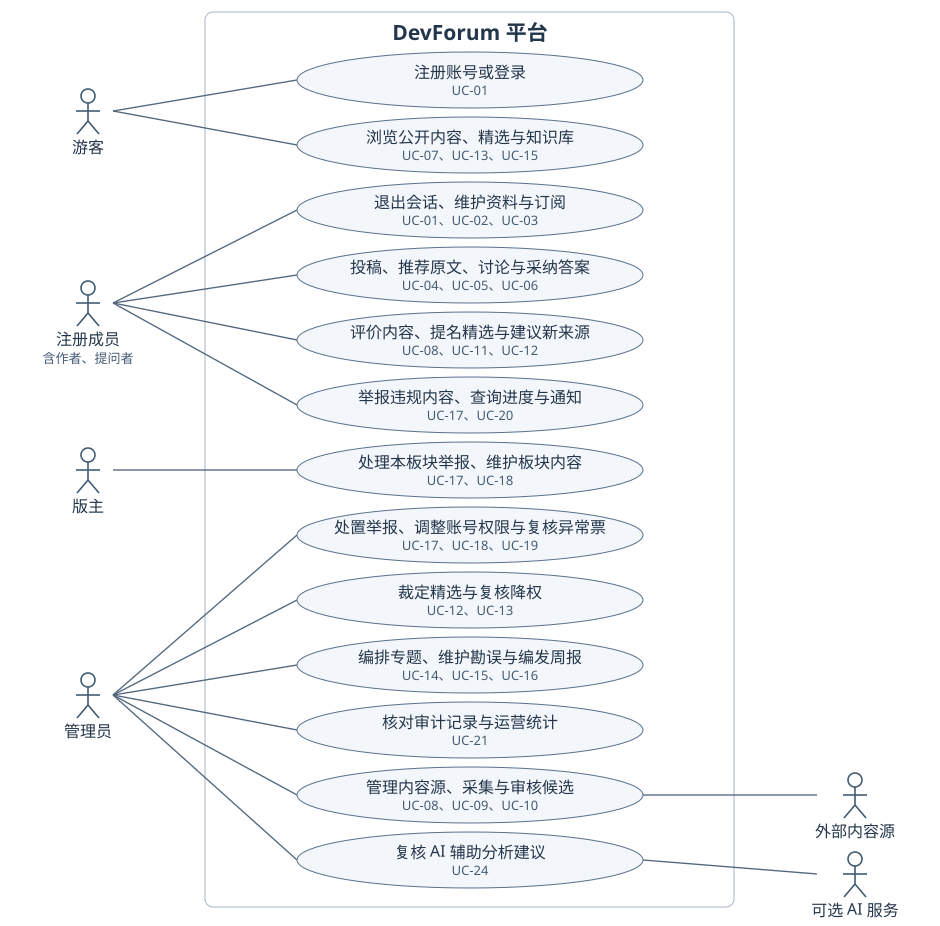
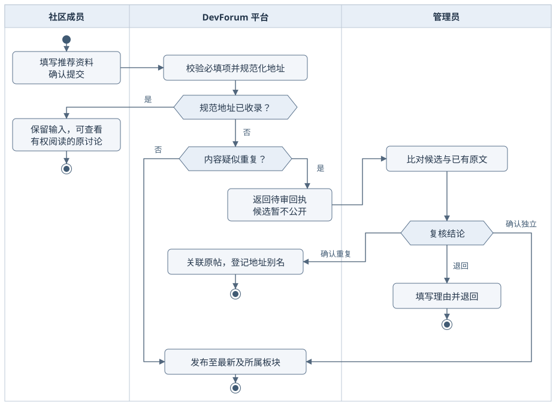
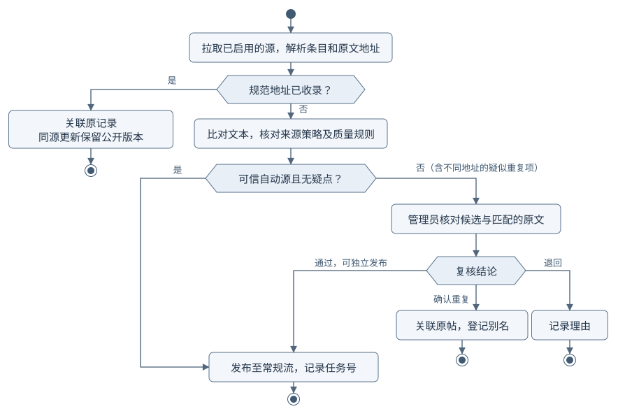
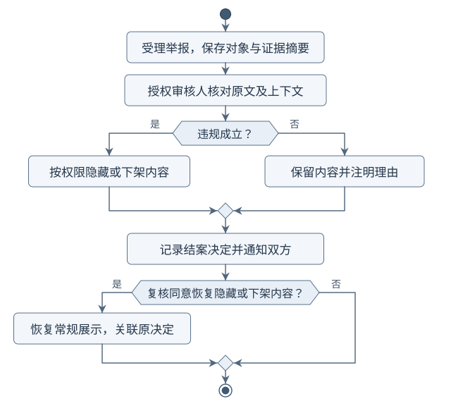
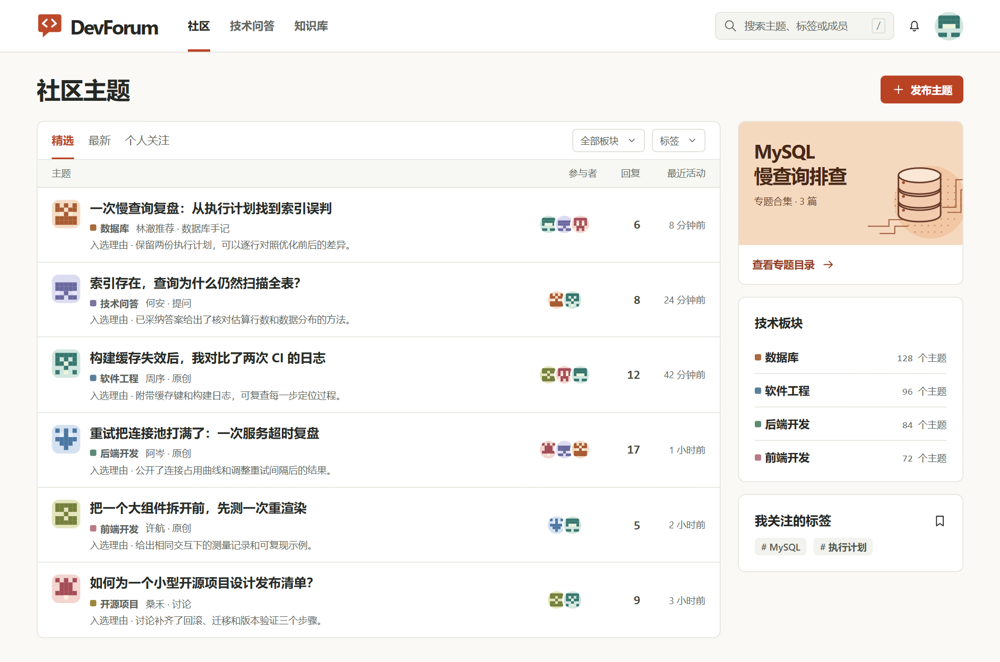
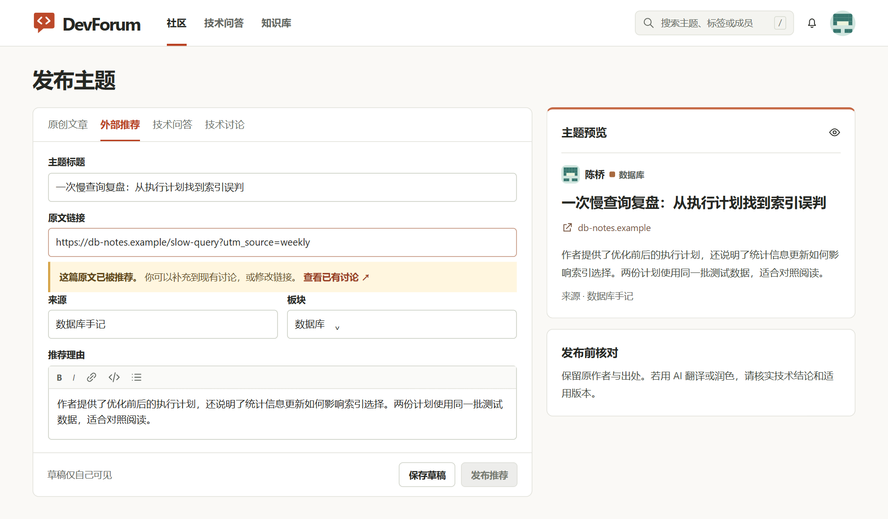
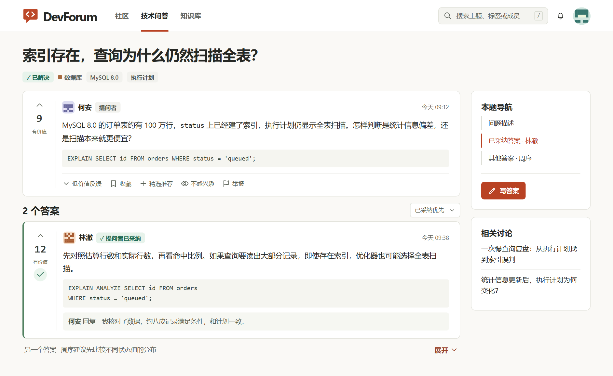
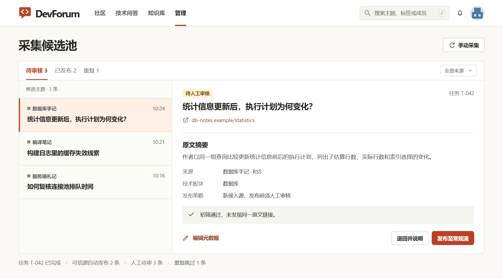
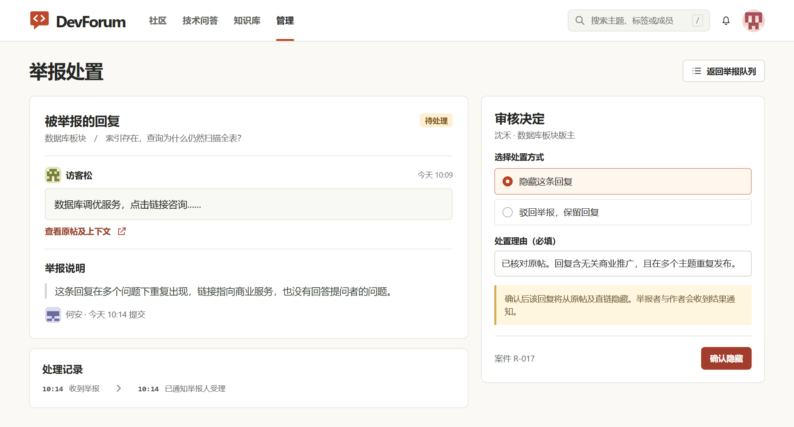
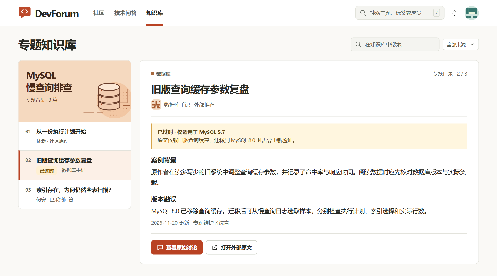

# DevForum 软件需求规格说明书

## 1. 目录

1. [目录](#1-目录)
2. [引言](#2-引言)
3. [战略分析](#3-战略分析)
4. [产品路线图](#4-产品路线图)
5. [用例与业务流程建模](#5-用例与业务流程建模)
6. [领域术语表](#6-领域术语表)
7. [补充规格与非功能需求](#7-补充规格与非功能需求)
8. [用户界面原型](#8-用户界面原型)

## 2. 引言

在日常研发中，开发者查找技术方案时，常面临方案真实性与时效性难以核验的困扰。很多网络文章缺少具体复现环境与版本信息，结论往往已经失效；而生成式 AI 的普及虽然降低了编写门槛，却也导致大量未经实践验证甚至存在幻觉的内容被发上论坛。

DevForum 面向愿意分享和核实工程经验的开发者。社区从团队整理的一批技术资料起步，成员可以发表原创文章、推荐站外资源，平台也会定期从可信来源收录新内容。推荐一篇文章时，成员需要附上原文链接，并写明值得阅读的理由。如果同一篇原文已经有人推荐，平台会引导成员回到已有讨论。后来读到这篇文章的人，既能查到最初的出处，也能看到其他人补充的测试结果或不同意见。

读者对内容的判断各有侧重。有人看过一篇复盘，认为其中的排查方法值得借鉴，可以标记“有价值”。有人只想少看这类话题，可以选择“不感兴趣”，这项选择只影响自己的阅读列表。如果回复中出现与问题无关的广告，读者可以举报，由版主核实处理。平台依据社区评价和成员推荐选出候选内容，再由管理员决定哪些文章进入精选首页，并记录入选理由。一篇讨论小众问题、但把测试过程写得很清楚的文章，也有机会被更多同行看到。

对于值得长期保留的经验，管理员可以把相关的文章、问答和讨论编入同一专题。即使某个配置选项在新版软件中已经移除，旧案例仍可供维护老系统的人查阅。知识库会标明适用版本，保留勘误说明和原讨论入口，帮助读者判断哪些做法仍然适用。

本说明书围绕上述使用场景，界定读者、贡献者、版主和管理员各自可以执行的操作，并将功能需求与用例、验收条件对应起来。对于访问权限、响应时间以及采集中断后的恢复等问题，文档也给出了可验证的要求，供开发和测试时共同参照。

## 3. 战略分析

### 3.1 SWOT 与 TOWS

| 维度 | DevForum 面临的条件 |
| --- | --- |
| S · 优势 | S1 原创、外部推荐与采集条目共用讨论和评价。S2 首页精选、常规发布、知识收录各有独立条件。 |
| W · 劣势 | W1 冷启动期独立评价少，窄领域文章容易无人发现。W2 课程团队可投入的人工审核时间有限。 |
| O · 机会 | O1 官方博客和技术周刊提供结构化订阅源。O2 有适用版本、勘误和原始证据的工程案例可以反复利用。 |
| T · 威胁 | T1 同一资源可能被不同地址反复转载，集中投票也会扭曲排序。T2 外部源不可用、内容变更或被投诉会影响可信度。 |

| 组合 | 采取的行动 | 对应目标 |
| --- | --- | --- |
| SO · S1 × O1 | 给种子条目和新增订阅条目保留出处与讨论入口，让一次采集能带来持续补充。 | G1 |
| WO · W1 × O2 | 先围绕“数据库故障复盘”建立一个可检索专题，为新发布且反馈少的案例保留探索位置。 | G2、G3 |
| ST · S2 × T1 | 同源链接归并。异常评价暂缓计分，恢复或撤销推荐都记录理由。 | G1、G2 |
| WT · W2 × T2 | 新源默认人工审核，将举报与低价值反馈分队列。优先处理仍公开可见的被举报内容。 | G4 |

### 3.2 业务目标、举措与验证

下列数字为课程演示的验收目标，业务效果尚待实际用户试用验证。验收数据应包含作者、链接、发布时间、内容状态及预期结果。

| 目标 | 举措 | 如何判断达成 |
| --- | --- | --- |
| G1 降低找资料和核实来源的成本 | 将四种来源纳入同一入口。外部推荐始终显示原文与推荐理由。 | 从空库导入 8 篇原文及其中 4 篇的等价地址，共 12 条输入。同批数据运行两轮后仍有 8 个唯一条目，均可追溯到原文。 |
| G2 让有依据的经验获得曝光 | 分开发布、评价和精选决策，为个人兴趣提供独立操作。 | 用普通新帖、已确认精选、仅被某人标为不感兴趣的帖子各一条，分别核对应出现的列表、个人过滤与全站评分（UC-11～13）。 |
| G3 让历史经验可以再用 | 专题保留原帖引用，检索结果和详情都展示时效标记。 | 在 1,000 条历史条目中预置 5 条带唯一关键词的案例。逐一检索均能打开对应原帖，其中 2 条过时案例均可看到更新说明。 |
| G4 让处置有据可查 | 分配审核权限，记录证据、理由、结果通知与恢复动作。 | 准备成立、不成立各 1 件举报。两条路径均能查到处置人、理由和通知，获准恢复的内容重新可见。 |

## 4. 产品路线图

下表按**拟定的六个实现周**排期。第 1 周从需求及设计评审后启动实现之日算起。每个增量均保留上一增量的演示数据，便于沿同一条资源检查整条链路。I3 是本稿划定的最小可行产品（MVP）验收点。

| 阶段 | 用户可见的增量 | 里程碑与退出条件 |
| --- | --- | --- |
| I1 · 第 1–2 周 | 账号与角色、种子导入、原创与外链推荐、常规内容流、搜索、讨论与问答。 | **M1**　成员可推荐文章、修订草稿并发布。第二名成员能找到它并回复。重复推荐能回到已有讨论。游客写入被拒绝。 |
| I2 · 第 3–4 周 | RSS/Atom 定时与手动采集、候选池、价值评价、精选流、举报审核及基础通知。 | **M2**　同一批样本重跑不重复入库。可信源自动发布进入常规流。评审员可分别演示精选通过与举报处置。 |
| I3 · 第 5–6 周 | 专题知识库与勘误、关注与收藏、信誉治理、站内通知完善、运营统计。 | **M3**　从原文到专题完成检索。演示过时提醒、举报恢复、通知及审计。复验 G1～G4 与第 7 节指标。 |
| E · MVP 后 | 接入有文档的公开 API，试用可选 AI 分析，扩展跨文关联与周期周报。 | 每项单独验收。断开 AI 时，采集、人工发布、精选和知识收录均可继续。 |

**依赖与取舍。** 接入外部源需要可读取的订阅端点。测试使用固定样本覆盖超时、重复和格式异常，另以一个实际配置的可用源验证接入。精选和知识库依赖已发布内容，故排在投稿之后。若评审调整阈值、范围或排期，在 issue 记录原因、影响的 FR/UC 与验收变动，由 PR 更新本稿并保留决议。

## 5. 用例与业务流程建模

### 5.1 系统边界与参与者

游客可以阅读公开内容。注册成员继承阅读权限，可投稿、互动和管理个人空间。提问者和作者仅在各自内容上取得采纳或编辑权。版主处理授权板块内的内容和举报。管理员维护全站内容源、精选、知识库、账号权限和审计。角色决定管理范围，信任等级决定成员可用的外链、精选推荐和评价权重。外部内容源返回条目，可选 AI 服务返回建议。定时调度属于平台内部。下图按用户目标汇总用例，具体编号、权限和验收见下一节。

### 5.2 功能需求与用例追溯矩阵

FR 表示功能需求，UC 表示用例。表内阶段对应第 4 节。同一行含不同阶段时明确标出增量。验收均从界面可见结果、可查询记录或服务响应判断。

| 需求 / 用例 | 角色与用户目标 | 系统行为与验收条件 | 阶段 |
| --- | --- | --- | --- |
| FR-01 / UC-01 | 访客注册，成员登录及退出 | 唯一账号可注册。正确凭据换取有时效的会话令牌，错误凭据被拒绝。退出后旧令牌无法再发帖。 | I1 |
| FR-02 / UC-02 | 成员维护个人主页 | 保存昵称、头像、简介和技术栈。另一读者可在主页看到公开的原创、推荐和贡献记录。仅本人可编辑资料。 | I1 |
| FR-03 / UC-03 | 成员回看资料、订阅更新 | 收藏与取消同步反映在个人收藏夹。关注作者、标签或内容源后，可在关注流看到匹配新帖，取消后相应订阅失效。本人可查看和清理浏览历史。 | I3 |
| FR-04 / UC-04 | 作者写作并管理帖子 | 原创文章、技术讨论、技术问答、外部推荐均可保存私有草稿。有效标题、板块及对应类型必填项齐全方可发布。正文支持 Markdown、代码高亮和标签。作者可编辑或删除自己的帖子，删除后公开入口同步撤下。 | I1 |
| FR-05 / UC-05 | 成员推荐站外资源 | 有外链权限者填写原文链接、来源和推荐理由。校验成功后进入最新及所属板块。等价链接显示已有条目入口并保留本次输入。 | I1 |
| FR-06 / UC-06 | 成员讨论，提问者采纳答案 | 帖子支持评论及分层回复。问答单列答案。仅提问者可选定一个最佳答案，更换后旧标记消失、记录保留，新获采纳者收到通知。 | I1，通知 I2 |
| FR-07 / UC-07 | 读者寻找合适的内容 | 提供精选、最新、板块、问答、知识库、个人关注六个入口。最新按发布时间倒序。关键词可与类型、板块、标签、质量状态组合并排序和分页。结果仅含读者有权阅读的条目。 | I1 常规入口，I2 精选，I3 知识库与关注 |
| FR-08 / UC-08 | 管理员维护可信源 | 可新增、编辑、启停来源，配置周期、领域和自动/审核发布策略。新源默认审核。停用后下一轮不发起拉取。成员只能提交来源建议供管理员决定。 | I2 |
| FR-09 / UC-09 | 管理员或内部调度发起采集 | 解析 RSS/Atom 的标题、作者、时间和原文地址。缺失的可选元数据标为未知。按规范 URL 与内容特征查重，来源信誉、领域和质量规则参与初筛。同源更新关联原记录，保留已公开版本供核对。失败有重试、日志和计数。 | I2，公开 API 适配 E |
| FR-10 / UC-10 | 管理员导入种子、审核候选 | 种子可批量导入并记录团队遴选理由。候选池支持筛选、批量选取、补全元数据、通过或退回。可信源可自动常规发布，新源、存疑项须人工复核。缺少原文链接的候选不可发布。 | I1 种子，I2 候选池 |
| FR-11 / UC-11 | 成员表达对内容的不同判断 | 有价值与低价值可撤销且互斥，重复点击不叠加。收藏保存个人记录并可作辅助信号。不感兴趣仅过滤本人的推荐与关注展示。举报建立案件，发起精选推荐建立候选。六种动作各有回执。 | I2，个人收藏与关注 I3 |
| FR-12 / UC-12 | 有权限的成员提名，管理员裁定精选 | 达到有效评价门槛或收到合资格提名后进入精选候选池。管理员也可主动遴选，并记录通过或退回理由。首版经管理员确认才进入精选首页。同一内容只出现一次。 | I2 |
| FR-13 / UC-13 | 读者浏览精选，管理员复核降权 | 精选按价值信号、评价者信誉和时间衰减排序。定期给符合条件的新内容探索曝光。有效低价值反馈达阈值则降权、撤出精选并送复核。管理员可带理由恢复。 | I2，信誉分层 I3 |
| FR-14 / UC-14 | 管理员收录知识并编排专题 | 选择已精选文章、优质外链或高价值问答，一次操作建立原帖引用。可维护专题封面、简介、目录及条目顺序。重复收录同一专题不会产生重复项。 | I3 |
| FR-15 / UC-15 | 读者检索历史资料，管理员补充勘误 | 可按关键词、标签、来源检索知识库。管理员可标记过时、补充版本、说明和时间。结果与详情均显示过时标记，详情保留原帖入口。可维护相关文章。 | I3，跨文关联 E |
| FR-16 / UC-16 | 管理员编发社区周报 | 按周期汇总本期可见精选条目，生成可编辑草稿。确认发布后进入公告与站内通知，同一周报重试发布仅生成一次通知事件。 | E |
| FR-17 / UC-17 | 成员举报，版主或管理员核实 | 举报含对象、类别及说明。提交后可查受理状态。审核员按板块和优先级处理，结论与理由可追溯。举报者收到受理和结果通知。 | I2 |
| FR-18 / UC-18 | 版主维护板块，管理员处置账号 | 版主在本板块可隐藏、恢复、锁定、置顶或提交加精。管理员可全站下架、恢复、删除、加精、调整权限或禁言封禁。锁帖后禁止新回复，隐藏或下架后普通读者从直链亦不可见。 | I2 内容，I3 账号 |
| FR-19 / UC-19 | 系统限制刷屏、异常投票和权限滥用 | 依注册时长、贡献、获评和违规记录更新信任等级。新号或受限号触达配额时提示等待。重复文本/回复被拦截。集中投票标记并暂缓计分，复核决定纳入或剔除。 | I1 基础权限，I3 动态治理 |
| FR-20 / UC-20 | 成员接收和管理站内消息 | 评论、回复、提及、答案采纳、入选首页或知识库、关注作者更新、举报进度及系统公告按接收者投递。收件人可单条或全部已读、查看归档，未读数随之更新。 | I2 核心事件，I3 完整收件箱，周报 E |
| FR-21 / UC-21 | 管理员查看审计与运营统计 | 可按时间查看质量状态分布、举报结案数、采集新增/重复/失败数，并从汇总追到相应案件或任务。自动操作与人工操作均留痕。 | I2 日志，I3 统计 |
| FR-22 / UC-24 | 管理员选择 AI 辅助分析 | 可按领域发现候选，生成相关性、同质化、实践证据、摘要、标签、推荐理由与入库建议。界面标明建议来源，允许编辑或丢弃。服务超时转人工，建议本身不赋予发布、精选或收录资格。 | E，可选 |

两个质量场景另有独立用例。**UC-22 权限隔离**由普通成员、跨板块版主和管理员分别对同一对象请求处置，验收见 NFR-02。**UC-23 故障恢复**由测试人员在写入后、任务确认前中断采集，再恢复任务，验收见 NFR-04。两者都通过业务正常入口验证。

### 5.3 关键用例详述

| 用例 | 进入条件与触发 | 成功路径 | 分支、异常及结束状态 |
| --- | --- | --- | --- |
| UC-05 推荐外部资源 | 成员已登录且具备外链权限，打开“发布 → 外部推荐”。 | ① 填写原文、来源、板块和推荐理由。② 系统校验并查重。③ 成员确认发布。④ 系统生成一条常规帖，显示原文入口并打开详情。 | 缺字段时在原处提示。等价地址已收录时给出已有讨论链接，草稿可继续编辑。两人同时提交同一地址，最多新增一条。 |
| UC-10 审核采集候选 | 已启用的源完成拉取，出现需审核的唯一候选。管理员打开候选池。 | ① 查看初筛理由、原文与来源策略。② 补全元数据并决定通过。③ 系统发布至最新和所属板块，记录任务号及审核人。 | 退回须填写理由。停用源中尚未审核的候选暂停发布。可信源的合规条目可以跳过人工审核，存疑条目仍排队。重复任务不得再次发布。 |
| UC-12 裁定精选 | 公开帖收到合资格提名、达到评价门槛，或被管理员主动选中。 | ① 系统汇集内容证据和有效评价。② 管理员核对适用条件、实践证据和利益冲突。③ 确认后条目显示于精选首页，贡献者收到通知。 | 退回保留常规发布并记录理由。后续达到低价值阈值则撤出首页并复核。恢复精选须再次记录决定。 |
| UC-17 处理举报 | 成员从可见帖子或回复提交举报，版主在授权板块打开案件。 | ① 系统保存对象和当时的证据摘要，反馈受理。② 审核人核对原文及上下文，选择处置并说明理由。③ 可见性随处置更新，记录结案并通知举报者和受影响作者。 | 不成立则保留内容并说明理由。超出版主权限则移交管理员。若两人同时处理，仅首次有效决定结案。复核恢复以新记录关联原决定。 |
| UC-15 检索并核实历史经验 | 读者知道错误现象或标签，知识库已有一篇含版本补充的复盘。 | ① 输入关键词，用标签或来源缩小范围。② 从结果看见过时提示。③ 打开条目，阅读适用版本、勘误和原讨论。 | 无匹配项时可清除筛选重新检索。原帖已被隐藏时，公开搜索、专题和直链均停止展示，管理员仍能查到审计引用。 |

### 5.4 业务流程与判定规则

**外部资源推荐。** 成员提交原文后，平台先查重。已收录的链接指向原有讨论，新链接发布到常规内容流。

**采集与候选审核。** 采集任务先关联已有条目。新条目按来源策略和初筛结果分流，需人工审核的候选可以通过或退回。

**举报处置与恢复。** 审核人核实证据后记录结论，平台将结果通知举报者和作者。复核同意恢复时，将新决定关联到原记录。

**发布、推荐和归档分别记录。** 一个内容对象有独立的发布状态（草稿、待审核、公开、隐藏、下架或已删除）、推荐状态（常规、候选、精选或降权）以及零到多个专题引用。常规帖子既可留在原讨论中，也可经选择收录知识库。隐藏、下架或删除优先于任何推荐、置顶或专题引用。隐藏与下架可由获授权人员恢复。删除后不提供公开恢复入口。恢复公开时按常规帖显示，重新加精需要新的决定。

**采集与去重。** 规范化只处理已知等价差异，如主机名大小写、片段和配置为跟踪用途的 `utm_*` 参数。保留影响正文的查询参数。规范地址相同直接关联已有条目。跨地址但标题及正文特征高度相似时，标记疑似重复，交管理员比较出处。导入种子需注明遴选人及理由。收录种子和自动发布外部条目均不能隐式取得首页精选。来源的授权与署名信息随条目保留，默认只展示元数据、摘要与原文链接。

**可重复演示的评价规则。** 首版评审样例设定为 3 名不同合资格成员给出“有价值”即可进入候选，或由 1 名具备精选推荐权的成员提名。3 名不同合资格成员给出有效低价值反馈则降权并送复核。异常票暂不计入。门槛是可调的演示初值，管理员直接遴选同样需要理由。其余条件相同，更多有效正向评价提高排序分，更久未更新的条目降低时效权重。高信任账号的有效评价权重较高。探索位从已确认精选且近期曝光较少的条目中轮换。低曝光的普通新帖可在板块中轮展并获得评价机会，“最新发布”始终按发布时间排序。

| 验收场景 | 给定 | 当 | 则 |
| --- | --- | --- | --- |
| AC-01 · UC-05、09 | 已收录一个原文地址 | 成员推荐带跟踪参数的同一地址，调度器同时拉取原文 | 均指向已有记录，原讨论保留，全站该原文的公开条目数仍为 1。 |
| AC-02 · UC-09、10 | 一个可信自动源和一个新源各新增一篇合规文章 | 同一轮采集成功 | 前者进入常规流，后者留在候选池。两篇均不出现在精选首页。 |
| AC-03 · UC-11～13 | 同一普通帖已有 2 个有效正向评价 | 第三名成员评价，随后重复提交。另一人选“不感兴趣” | 有效票数为 3，候选仅 1 项。该读者的推荐展示过滤此帖。管理员确认后，其他读者才在精选看见它。 |
| AC-04 · UC-14、15、17 | 已收录的公开帖被举报并判定须隐藏 | 版主确认后，读者从专题、搜索和旧直链打开 | 三处均不再展示正文。复核恢复后专题指向同一原帖，审计能还原两次操作。 |
| AC-05 · UC-06、20 | 同一问题已有两个不同成员的答案 | 提问者采纳第一个，后来改采纳第二个。其他成员尝试修改 | 仅第二个有“已采纳”标记，两次采纳的接收者各收到对应通知，其他成员的请求被拒绝。 |

## 6. 领域术语表

| 术语 | 在 DevForum 中的含义 |
| --- | --- |
| 初始精选库（种子库） | 冷启动时人工遴选并导入的资源集合，每条均保存原出处与遴选理由。 |
| 可信内容源 | 管理员维护、可按策略采集的博客、周刊或其他外部订阅端点。 |
| 规范化 URL | 去除已知跟踪差异后用于识别同一原文的地址。原始地址同时保留。 |
| 待发布内容池 | 保存已采集、尚未公开的候选条目及其初筛结果的工作区。 |
| 常规内容流 | 公开帖子首次可见的最新列表及所属技术板块。 |
| 价值评价 | 有价值或低价值两种可撤销的质量判断，同一成员对同一帖最多保留一种。 |
| 精选候选池 | 保存已公开、等待精选裁定的帖子，与待发布内容池处于不同业务阶段。 |
| 精选首页 | 展示已获精选资格且仍可公开阅读的条目的社区首页。 |
| 信任等级 | 根据账号历史、贡献质量和违规记录确定的成员权限与评价权重层级。 |
| 时间衰减 | 其他条件相同时，随时间推移降低内容推荐排序权重的规则。 |
| 探索曝光 | 在合资格内容中给低曝光条目分配展示机会，使其获得独立评价。 |
| 降权 | 减少内容在推荐位置的曝光，仍可按其发布状态在常规流中访问。 |
| 举报案件 | 关联具体对象、证据、举报类别、处理人、结论与通知的处置记录。 |
| 技术专题 | 知识库里按主题人工编排的一组条目引用，支持排序和跨来源组织。 |
| 勘误与过时标记 | 勘误补充或纠正原结论。过时标记提示适用环境已变，二者均保留历史依据。 |
| 最佳答案 | 由该问题的提问者选定的一个答案。更换后仅新答案显示采纳标记。 |

## 7. 补充规格与非功能需求

以下均为待验证的验收指标。性能测试在记录配置的同一验收环境中运行，使用 1 万条公开内容、1 千个账号、10 个板块的固定样本。记录应用版本、机器配置、样本版本和耗时分布，以便迭代间复测。

| 编号 / 属性 | 可验证要求 | 验收方法与关联用例 |
| --- | --- | --- |
| NFR-01 性能 | 在 20 个并发读者下，最新列表及组合搜索各自端到端响应时间的第 95 百分位 ≤ 2 秒，服务端错误率 < 1%。 | 预热 1 分钟，持续 5 分钟分别访问两类入口，各至少 500 次，分别统计。外部采集单独运行。UC-07、15 |
| NFR-02 身份与授权 | 身份、角色和对象归属在服务端校验。匿名写入被拒绝，跨账号修改草稿、跨板块处置和普通成员加精均被拒绝且原记录不变。密码只存储带盐口令散列，令牌和密码不得进入日志。 | 以游客、两名成员、版主、管理员重放同一组请求，核对状态、数据库与日志，另验退出后的令牌。UC-01、04、17、22 |
| NFR-03 内容安全与隐私 | Markdown、采集摘要及评论中的活动脚本不可执行。采集器仅访问获准的公开 HTTP(S) 端点。个人草稿、收藏夹、浏览历史和收件箱只对所属账号开放。 | 在正文、摘要和评论各放入一个含脚本的样本。核对页面仅显示安全内容。以另一账号访问私有记录，并以受限地址作为测试源，均应拒绝。UC-03、04、09、20 |
| NFR-04 一致性与恢复 | 同一批次、同一成员动作或同一通知事件重试不会多写有效记录。单源超时最多自动重试 3 次，耗尽后标记失败，其他源仍完成，管理员可手动重跑。 | 在条目写入后、任务确认前中断并恢复。比较规范地址、有效票、通知和任务日志。故障源恢复后应只补齐缺失条目。UC-09、10、11、20、23 |
| NFR-05 可访问性与适配 | 桌面 1280 像素及移动 360 像素宽均可完成搜索、推荐和举报。核心表单可全程用键盘操作，焦点可见。错误、过时与审核状态均有文字。 | 在两种视口依次完成三项任务。仅用键盘定位错误字段、改正并提交，检查正文及主要控件无横向裁切。UC-05、07、15、17 |
| NFR-06 通知及时性 | 在验收环境中，评论回复、采纳及结案成功后，接收者刷新收件箱能在 10 秒内见到消息。重试投递不增加未读数。 | 每类制造 10 个独立事件，记录提交与首次可见时间。重放同一事件后核对消息总数和未读数。UC-06、17、20 |
| NFR-07 可审计性 | 每次审核、角色调整和自动发布均记录时间、操作者或任务号、目标、前后状态与理由。普通成员无法改写审计记录。 | 抽取一次通过、退回、隐藏、恢复、权限调整和自动发布，逐项追溯。以成员身份尝试改写并核对原值。UC-10、12、17、18、21 |
| NFR-08 外部依赖降级 | 外部源格式错误只影响该源。启用可选 AI 后，服务超时可转入规则初筛或人工队列，已公开内容可照常访问。 | 提供 1 个无效订阅和 1 个正常订阅。模拟 AI 超时并查看失败原因、正常源结果和可操作的人工候选。UC-09、10、24 |

**业务约束。** 站外条目保留来源与署名，在未确认授权时只收录可引用的信息与链接。投稿界面说明可使用 AI 翻译、润色或整理，并要求作者核实技术结论。AI 建议保留来源标识。人工审核、精选与版务决定应能追溯到负责账号。首版规则参数、演示数据与审核人权限应在验收记录中注明。

## 8. 用户界面原型

下列六屏使用同一组社区主题演示阅读、投稿与审核。主题列表参考论坛按板块、回复数和最近活动浏览讨论的方式，问答页用勾选标记指出提问者已采纳的答案。数字、账号和文章均为示例。[Discourse 主题列表](https://meta.discourse.org/latest) · [V2EX 主题与节点](https://www.v2ex.com/) · [Stack Overflow 采纳标记说明](https://stackoverflow.com/help/accepted-answer)

### 8.1 精选首页

读者可以从“精选”切换到“最新”或“个人关注”，也可按板块和标签筛选。每行直接给出入选依据，右侧的回复数与最近活动时间帮助读者找到仍在讨论的主题。对应 UC-03、07、12、13。

### 8.2 发布外部推荐

成员在左侧填写原文、板块和推荐理由，右侧预览读者将看到的帖子。图中原文已被收录，链接输入框下方给出已有讨论入口，成员也可修改链接或保存草稿。对应 UC-04、05。

### 8.3 问答详情

原帖保留环境与查询语句，采纳答案展示验证方法，答主下方紧接提问者的实测反馈。答案旁的勾表示提问者的采纳决定，旁边的数字记录成员给出的“有价值”评价。对应 UC-06、11、17、20。

### 8.4 采集候选池

管理员在左侧候选队列选中条目，可在右侧核对原文、摘要、来源策略和查重结果，再编辑元数据、退回或发布到常规流。下方任务摘要区分自动发布、人工待审和重复跳过的数量。对应 UC-08、09、10、21。

### 8.5 举报处置

左侧并列展示被举报回复、举报人说明和原帖入口。版主可在右侧选择隐藏回复或驳回举报，填写理由后确认。确认前可看见该决定对可见性和通知对象的影响。对应 UC-17、18、20、21。

### 8.6 专题知识库

读者从左侧专题目录选择条目，在右侧阅读案例和版本勘误。过时标记在目录与正文均可见，页末保留原始讨论和站外原文两个入口。对应 UC-07、14、15。
